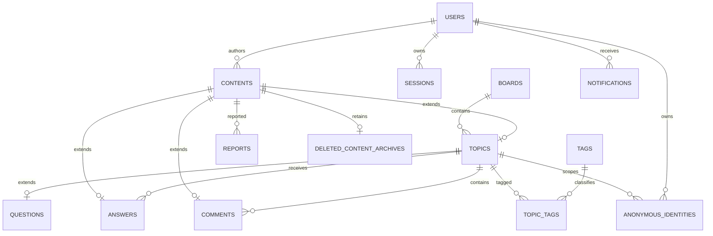

# 数据模型草案

状态：逻辑模型，已生成首版SQL迁移，物理字段与事务规则以[数据库设计](database-design.md)及server/migrations为准。MySQL 保存持久业务数据，Redis 用于限流、验证码等短期状态，不作为内容和通知的唯一存储。真实MySQL执行验证仍待环境恢复。

## 设计约定

- 内部主键使用 BIGINT，公开用户标识使用独立生成的不可预测标识；HTTP 中大整数 ID 序列化为字符串。
- 时间以 UTC 保存，界面按用户时区展示。
- 所有内容统一进入 contents，主题、回答和评论分别有扩展表；举报和通知只引用 contents，避免多态外键失去完整性。
- 本文状态字段使用命名值表达；具体 MySQL 类型、长度、索引和字符集在迁移阶段定稿。
- 用户密码、验证码、会话凭证均不保存可直接使用的明文。

## 实体关系

## 字段字典

除关联表外，按需要包含 created_at、updated_at。下表为业务关键字段，并非完整 DDL。

| 表 | 关键字段 | 约束与说明 |
|---|---|---|
| users | id, public_id, email_normalized, password_hash, nickname, avatar_attachment_id, bio, role | public_id、email_normalized 各自唯一；nickname 不唯一；role 为 user/admin；接口account_status从有效处罚派生，不重复落库 |
| sessions | id, user_id, token_hash, csrf_token_hash, expires_at, revoked_at | token_hash 唯一；Cookie 仅保存随机凭证，使用 HttpOnly/Secure；会话可撤销；CSRF独立校验 |
| boards | id, name, description, kind, sort_order, is_archived | kind 为 discussion/qa；已有主题后不能直接改类型 |
| contents | id, author_id, kind, body_md, is_anonymous, anonymous_identity_id, moderation_status, deleted_at, edited_at | kind 为 topic/answer/comment；moderation_status 为 visible/hidden，与删除独立；删除时移走正文 |
| topics | content_id, board_id, title, is_locked, is_pinned, last_activity_at | content_id 同时为主键与外键；类型由板块决定；删除时移走标题 |
| questions | topic_id, resolution_status, resolved_at | topic_id 主键；只属于 Q&A；open/solved；重新打开时清空 resolved_at |
| answers | content_id, question_id | content_id 主键；question_id 引用 questions.topic_id |
| comments | content_id, topic_id, answer_id, parent_comment_id, reply_to_comment_id | answer_id 可空；parent_comment_id 仅用于两层展示，指向顶层评论；reply_to_comment_id 是真实回复父节点，决定递归删除关系 |
| anonymous_identities | id, topic_id, user_id, display_number | 唯一(topic_id,user_id)和(topic_id,display_number)；仅公开讨论内编号，不公开 id/user_id |
| tags | id, name, normalized_name, description | normalized_name 唯一；第一版由管理员维护，用户选择（已确认） |
| topic_tags | topic_id, tag_id | 联合主键；应用层限制每主题标签数 |
| attachments | id, owner_id, storage_key, mime_type, byte_size, status, delete_after | storage_key 唯一且不含身份；先上传后关联；待关联图片仅所有者可读；未关联的待用附件24小时后清除，内容删除后不再被引用的附件7天后物理清除 |
| content_attachments | content_id, attachment_id | 联合主键；附件通过可见关联内容授权，不能只依靠静态文件 URL |
| notification_preferences | user_id, email_on_comment, email_on_answer, email_on_reply | user_id 主键；注册时的缺省值为评论邮件关闭、回答与回复邮件开启（2026-10-14定），用户可在设置页修改 |
| topic_subscriptions | user_id, topic_id, email_override | 联合主键；override 为 inherit/enabled/disabled；单篇设置覆盖全局默认。**没有这一行＝inherit（跟随全局）**；邮件里的退订链接、以及界面上的"跟随全局"都表现为删除该行，而"这个主题不发邮件"才写入 disabled |
| notifications | id, recipient_id, event_key, event_type, content_id, read_at | 唯一(recipient_id,event_key)；避免存储作者身份和正文快照 |
| outbox_events | id, event_key, event_type, content_id, recipient_id, status, available_at, lease_until, lease_token, attempts | 与业务写入同一事务；event_key 唯一；工作进程生成通知/邮件任务；租约令牌防止旧工作进程确认 |
| email_deliveries | id, recipient_id, event_key, purpose, content_id, status, next_attempt_at, lease_until, attempts, sent_at | 唯一(recipient_id,event_key,purpose)；发送前读取内容和偏好；不持久复制删除正文 |
| reports | id, reporter_id, content_id, reason, details, status, handler_id, resolution_note, resolved_at, active_slot | pending/processing/resolved/dismissed；reason使用文本；未结案的重复举报以生成列唯一索引保护 |
| user_restrictions | id, user_id, kind, reason, starts_at, ends_at, revoked_at, created_by | kind 为 mute/ban；ends_at 可空表示永久；禁言有效性按时间判断 |
| moderation_actions | id, actor_id, target_content_id, target_user_id, action, reason, report_id | 只追加；管理、追溯匿名身份和读取删除原文均审计；不存原正文 |
| deleted_content_archives | content_id, original_title, original_body_md, deleted_by, deleted_at, purge_after | content_id 主键；purge_after=deleted_at+30天；专用审核权限访问，到期物理清除 |
| settings | id, smtp_host, smtp_port, smtp_security, smtp_username, smtp_password_ciphertext, smtp_from_address, smtp_from_name, captcha_ttl_seconds, captcha_max_attempts, email_code_ttl_seconds, email_code_max_attempts, email_code_resend_interval_seconds, email_code_email_hourly_limit, email_code_ip_hourly_limit, login_captcha_failure_threshold, updated_by | 单行表，id由CHECK固定为1；表中没有明文密码列，SMTP密码只存AES-GCM密文，密钥来自环境变量；数值列带上下限CHECK；修改写moderation_actions审计且只记录字段名。迁移000003已加入图片限制列（单张字节上限、像素上限、每篇张数、待用附件保留小时数、孤儿清理天数），与账号参数共用同一后台入口 |

## 一致性规则

1. 创建内容与扩展行必须同一事务；每个 contents 恰好有一个与 kind 相符的扩展行。
2. 普通板块不允许创建 questions，Q&A 板块的主题必须有 questions；第一版移动主题只允许同类型板块。
3. 评论的 topic_id 必须与 answer_id 所属问题一致；parent_comment_id 必须为同一目标下的顶层评论；reply_to_comment_id 必须处于同一串。顶层评论两者均为空，回复必须两者非空；直接回复顶层时两者相同。回复关系只指向已存在记录，发布后不可修改，禁止自引用与环。单独删除评论沿 reply_to_comment_id 递归寻找后代；删除顶层评论涵盖整串，删除中间回复不波及无关分支。应用事务校验，必要时用复合外键加强。
4. 匿名映射必须属于内容作者与当前主题。创建匿名主题时先写内容与主题，再创建映射并回填，全部在同一事务完成。
5. 内容匿名标记发布后不可修改；实名内容不向外暴露匿名映射。匿名主题作者自答、发布评论或回复时，服务端根据根主题作者和匿名标记强制 is_anonymous=true，复用讨论内匿名映射，对外显示“楼主”；客户端参数不可绕过，公开响应不得包含真实作者信息。匿名编号并发分配需要锁或唯一冲突重试。自答继承匿名已确认。
6. 解决状态变更通过内容作者所有权校验；已解决时间只在状态变更时更新。新增回答、评论、回复与切换解决状态统一先锁定根主题记录；问答事务内确认问题为 open，主题及目标祖先均未删除、未隐藏且未锁定，再写入。包括回答下的评论和提问者自己的回复，防止状态检查与插入之间的竞态。
7. 连带软删除范围：帖子→全部评论及回复；问题→全部回答、评论及回复；回答→其下全部评论及回复；评论→沿真实回复关系递归的全部后代。同一事务保存所有新删除内容的审核原文、清空公开正文/标题并设置 deleted_at。新增、解决状态变更和删除统一先锁定根主题，再操作下属记录；事务回滚时不能出现部分删除。重复删除不得延长已删除后代的保留期。读取审核原文也必须检查 purge_after，即使清理任务延迟也不可访问。
8. 删除、隐藏会产生失效事件，取消未发送通知或在发送前跳过；异步工作不能依赖未过滤的旧正文。
9. 举报未结案唯一约束可采用生成列 active_slot（未结案为1，结案为NULL）与唯一(reporter_id,content_id,active_slot)。
10. 30 天清理删除审核原文与无其他有效引用的附件，保留空内容行及回复关系。日志禁止记录请求正文和验证码；备份采用独立到期策略。
11. 内容外键不使用物理 ON DELETE CASCADE；业务层显式执行已确认的连带软删除，以保留30天审核原文和审计关系。用户注销涉及内容匿名化，属于后续单独设计范围。

## Redis 临时数据

| 用途 | 逻辑键范围 | 生命周期 |
|---|---|---|
| 图形验证码 | 随机 challenge ID + 用途 | 短期 TTL，验证/消费原子化 |
| 邮件验证码 | 邮箱不可逆标识 + 用途 + challenge ID | TTL、尝试计数、单次消费；低熵验证码用带密钥摘要 |
| 限流 | IP/邮箱/用户 + 操作 | 按窗口过期，原子计数 |
| 重发冷却 | 邮箱标识 + 用途 | 短 TTL，原子占位 |

Redis 不可用时验证码和受保护发送操作失败关闭，不能绕过校验。邮件发送后才开始记录验证码会产生竞态，需预先登记挑战并协调发送状态；异步邮件验证码载荷不得明文持久化或写日志。

## 索引与检索建议

- topics(board_id,is_pinned,last_activity_at,content_id) 支持板块列表；另设创建顺序查询。
- contents(author_id,created_at,id) 支持私有内容列表；公开主页必须额外过滤匿名和可见性。
- contents 的 `body_md` 与 topics 的 `title` 各有 ngram 全文索引（迁移 `000004_search_indexes`），供公开搜索使用；它们是唯一为检索而建的索引，其余索引都服务于列表与事务。
- answers(question_id,content_id)、comments(topic_id,answer_id,parent_comment_id,content_id) 支持讨论读取。
- comments(reply_to_comment_id,content_id) 支持评论后代遍历；两层展示不意味着真实回复关系只有两层。
- questions(resolution_status,topic_id)、topic_tags(tag_id,topic_id) 支持筛选。
- notifications(recipient_id,read_at,id)、reports(status,created_at,id) 支持通知和管理队列。
- outbox_events(status,available_at,id)、email_deliveries(status,next_attempt_at,id) 支持任务领取。
- deleted_content_archives(purge_after,content_id) 支持分批清理。
- 中文检索已落地：`contents.body_md` 与 `topics.title` 各有一个 ngram 全文索引（迁移 `000004_search_indexes`），查询用 `MATCH … AGAINST(… IN BOOLEAN MODE)` 的短语形式；短于一个 ngram 词（默认 2 字）的查询回退到 `LIKE` 扫描，因为索引对它产生不出 token。**仍需验证的是检索质量**（分词、同义词、词序）与实际语料，不是索引方案；不引入独立搜索服务。检索不得包含删除审核表，结果仍需检查可见性（实现上先由 SQL 缩小候选，再走共享的祖先可见性规则，最后逐条复用与其它读取相同的读取器）。

## 实现前需定稿

- Go 路由/数据库访问库、React 构建方式、MySQL 与 Redis 版本。（已定：Go 1.26标准库HTTP与database/sql、React + Vite + TypeScript、MySQL 8.4、Redis 8.2-alpine。）
- Markdown 渲染库、图片存储路径与清理策略、中文搜索实现。（内容阶段已定：服务端 goldmark 校验 + 前端 markdown-it 白名单渲染、`data/media` 存储目录、待用附件24小时与孤儿附件7天两段清理；中文检索的分词方案仍待语料验证。）
- SMTP 服务与发信域名、验证码参数、邮件偏好默认值。（账号阶段已定：验证码与限流参数、邮件偏好默认值见需求文档，且改由管理员后台维护；真实SMTP已确认为阿里云邮件推送 `smtpdm.aliyun.com:465`（隐式TLS）并已真实投递验证，页面品牌风格仍待确认。密码哈希用 argon2id，会话有效期30天。）
- 备份窗口与删除原文的备份清除边界：业务库 30 天清理不自动等于备份同时清除。
